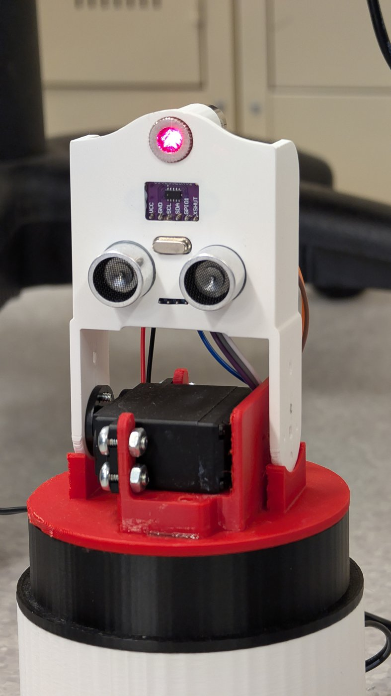
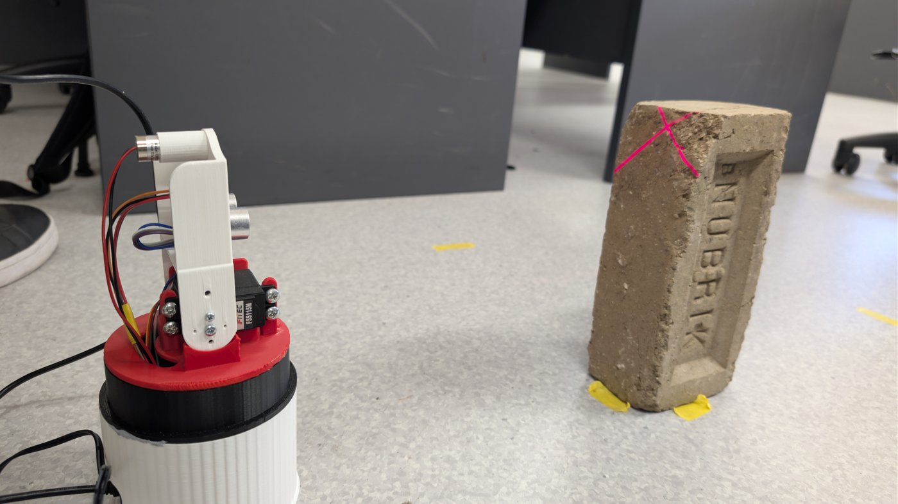
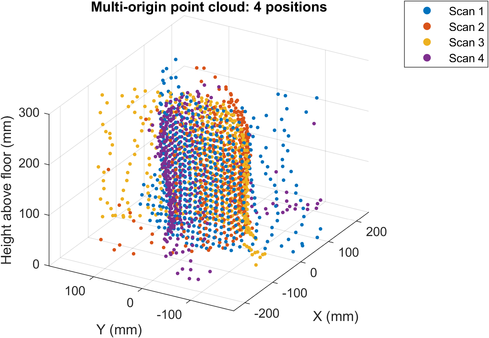
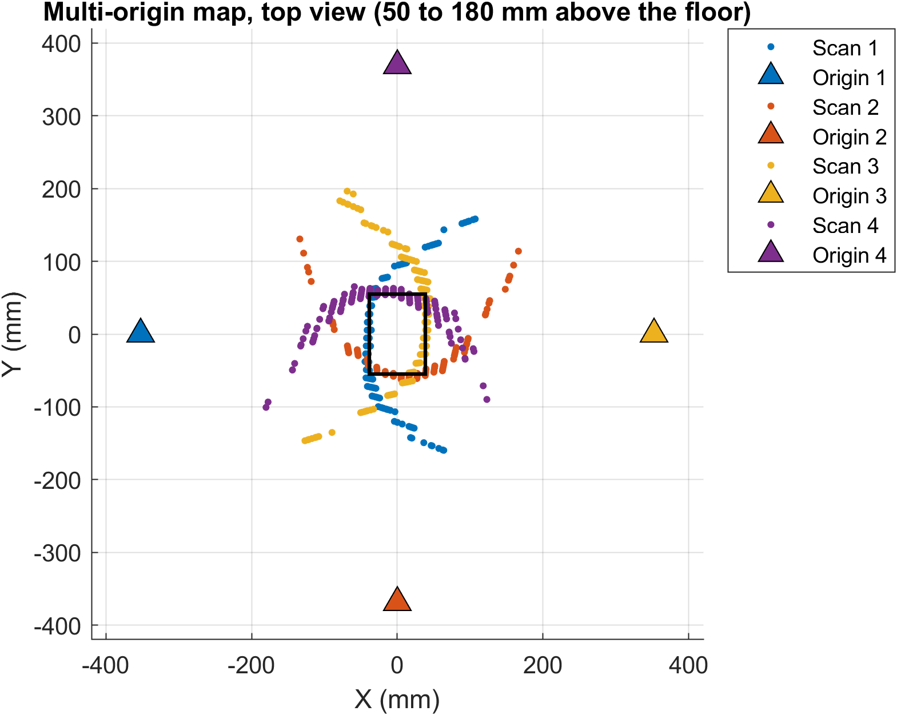
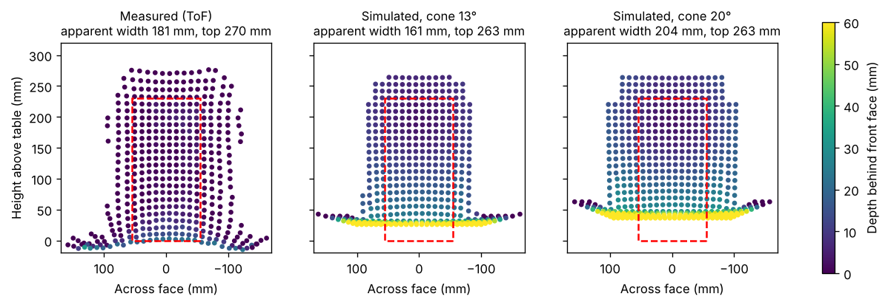
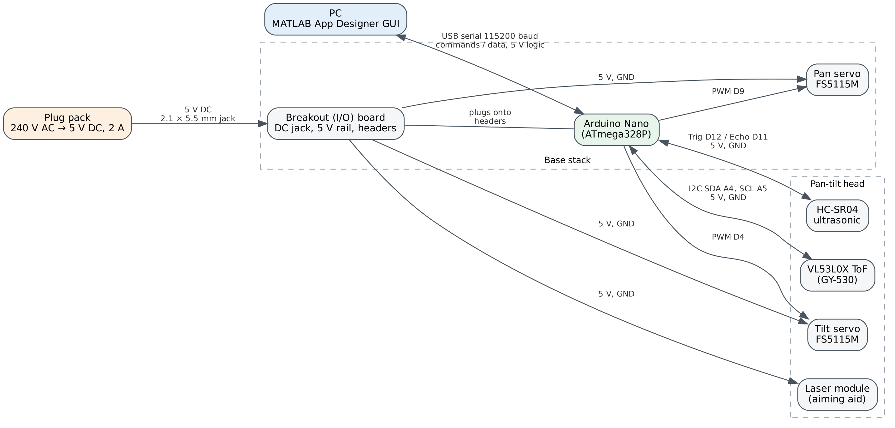
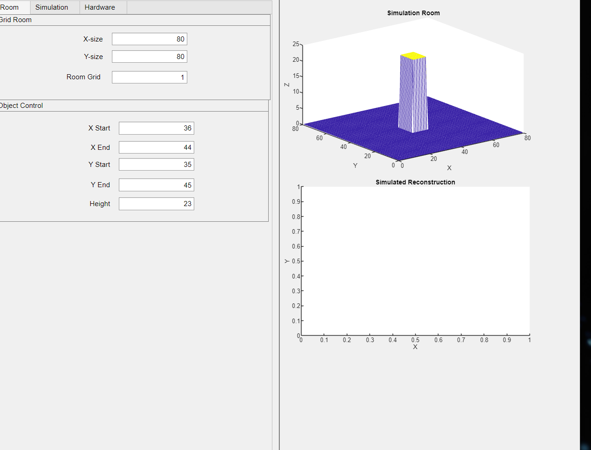
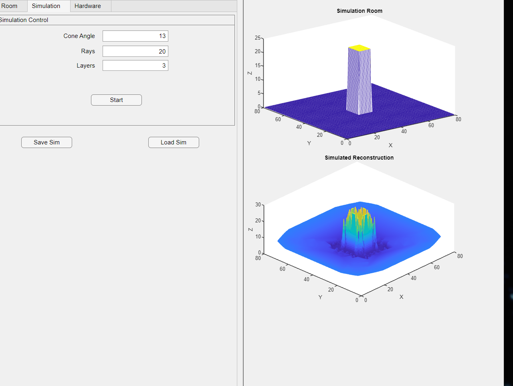
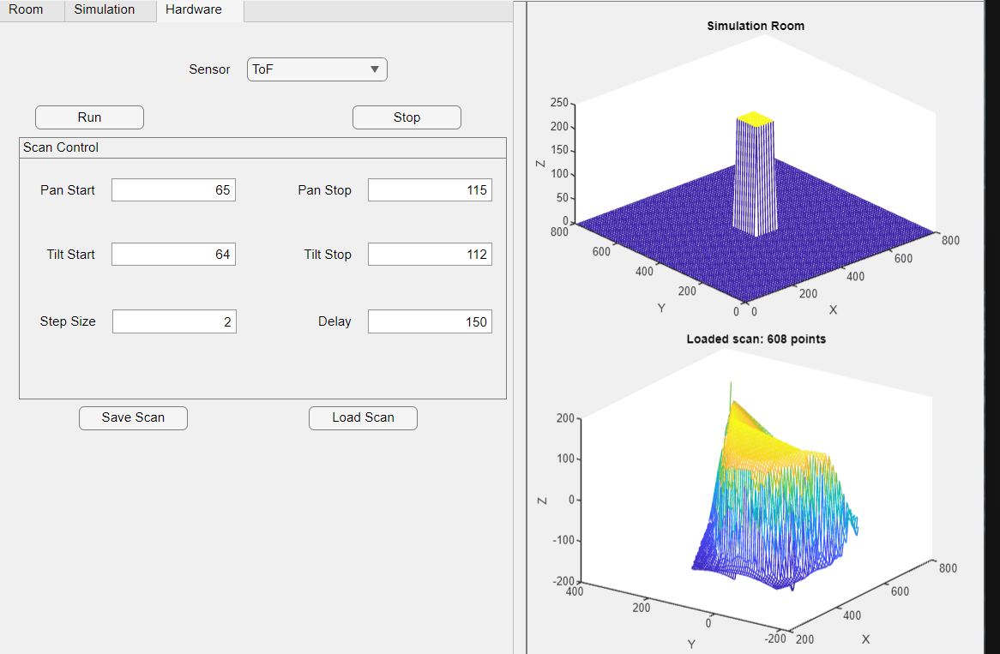

# Pan-Tilt 3D Scanner

A low-cost 3D scanner built around a VL53L0X time-of-flight sensor and an HC-SR04 ultrasonic sensor on a 3D-printed pan-tilt head. An Arduino Nano drives the servos and streams readings over serial to a MATLAB App Designer GUI, which plots the scan live and reconstructs it as a 3D surface or point cloud. The same GUI also runs a cone-beam simulation of the sensor, so you can compare simulated and measured scans side by side.

I built this for ELE3PRO (Third Year Project) at La Trobe University in 2026. I did the CAD, 3D printing, wiring, firmware, GUI, calibration and testing.

<p align="center">
  
  
  
</p>

## Results

All tests used a 110 × 77 × 230 mm brick placed 314 mm from the scanner.

- **ToF calibration:** reading = 1.0365 × true + 15.7 mm, residuals within ±2.5 mm
- **Repeatability:** 0.97 mm standard deviation over 10 line scans
- **Front face position:** 312–314 mm measured vs 314 mm actual
- **ToF beam angle:** 12–13°, measured two ways (line scan and 3D scan)
- **Four-position scan:** front face within 3 mm of the true outline, other faces within 6–9 mm
- **Ultrasonic vs ToF:** the ultrasonic sensor read about 40 mm short and has a much wider beam (~29°), so ToF gives much cleaner shapes

The main limit is beam width. A 12–13° cone makes the brick look 35–77 mm bigger than it is. Once I changed the simulation from the 20° cone used in the labs to the measured 13° cone, the simulated widths came within 11–16 mm of the measured ones.

<p align="center">
  
  
</p>

## How it works

**Hardware**

| Part | Connection |
|---|---|
| Arduino Nano | USB to laptop, 115200 baud |
| Pan servo (FS5115M) | D9 |
| Tilt servo (FS5115M) | D4 |
| VL53L0X ToF (GY-530) | I2C, A4 (SDA) / A5 (SCL) |
| HC-SR04 ultrasonic | Trig D12, Echo D11 |
| Laser pointer module | 5 V rail |
| Power | 5 V 2 A plug pack into the breakout board (servos + laser) |

I designed the housing in SolidWorks and printed it in PLA on a Prusa MK4. The upper plate sits on the pan servo plate so the plate carries the weight of the head, not the servo horn.



**Firmware (`arduino/Scanner/Scanner.ino`)**

- Takes single-letter commands over serial, e.g. `a2 c65 d115 e64 f112 h150 u0`, then `r` to run
- Sweeps in a serpentine pattern: tilt direction flips every pan column, so the head never moves back without taking readings
- Sends one tab-separated line per point: `pan  tilt  tof_mm  us_mm`
- Only turns on the ultrasonic sensor when asked (`u1`), because each echo wait adds up to 30 ms per point
- `s` stops a scan at any time

| Command | Meaning | Command | Meaning |
|---|---|---|---|
| `r` / `s` | run / stop | `c` / `d` | pan start / stop |
| `v` | print settings | `e` / `f` | tilt start / stop |
| `a` | step size, both axes | `g` / `h` | pan / tilt settle delay (ms) |
| `p` / `t` | pan / tilt step only | `u1` / `u0` | ultrasonic on / off |

**MATLAB GUI (`matlab/Demo_code.mlapp`)**

The GUI has three tabs:

- **Room:** build a test room with a box-shaped object
- **Simulation:** cast a cone of rays from each scan angle using ray-triangle intersection (runs in parallel with `parfor` if the Parallel Computing Toolbox is installed)
- **Hardware:** send scan settings, plot points live as they arrive, then reconstruct

<p align="center">
  
  
  
</p>

`ReconstructHardware.m` does the processing in five steps:

1. Drops out-of-range readings (ToF timeout = 8190)
2. Applies the ToF calibration
3. Corrects for the sensor sitting 12.7 mm in front of and 69.8 mm above the tilt axis
4. Converts pan/tilt/distance to x, y, z
5. Fits a surface (line scans fall back to a scatter plot)

`MultiOriginScan.m` merges scans taken from 2–4 positions around an object into one point cloud, using each position's origin and heading.

## Repository layout

```
arduino/Scanner/Scanner.ino   firmware (ToF + ultrasonic)
matlab/                       GUI app, reconstruction functions, test scripts
data/                         raw scans used for the results above (.mat)
cad/                          full assembly (zipped STEP) and part drawings
docs/images/                  photos, plots and diagrams
```

**MATLAB files**

| File | What it does |
|---|---|
| `Demo_code.mlapp` | GUI: room, simulation and hardware tabs |
| `ReconstructHardware.m` | filter, calibrate, offset-correct and reconstruct measured scans |
| `ReconstructData.m` | reconstruct simulated scans |
| `RunConeScan.m`, `measure_distance_cone.m`, `measure_distance.m` | cone-beam sensor simulation |
| `RoomGenObject.m` | generates the simulated room |
| `MultiOriginScan.m` | merges scans from several positions |
| `Lab8_Task1_capture.m` | line scan capture from a script |
| `Lab8_Task2_reconstruct.m` | reconstructs the Task 1 capture |
| `Lab8_Task3_characterise.m` | repeatability and beam-angle tests |
| `DisplayScatter.m` | point-cloud plotting |
| `TriangleRayIntersection.m` | ray-triangle intersection (third-party, see Credits) |

## Running it

**You need:** MATLAB R2019b or newer (I built it in R2024a). The Parallel Computing Toolbox is optional. For the firmware, you need the Arduino IDE and the **VL53L0X library by Pololu** (install it from the Library Manager).

1. Upload `Scanner.ino` to the Nano. Open the Serial Monitor at 115200 baud and send `v` to check it's responding, then close the Serial Monitor.
2. Change the serial port in the GUI's `startupFcn` (and in `Lab8_Task1_capture.m`) from `COM8` to your board's port.
3. Run `Demo_code.mlapp`. Use the Hardware tab to set the range and step, then press **Run**.
4. To try reconstruction without hardware, load any file from `data/` with **Load Scan**, or run `MultiOriginScan.m` from the `data/` folder.

**Calibration constants (specific to my build)**

- Servo centres: pan 90; tilt is level at raw 100 on this build (it increases upwards)
- Tilt axis: 128.5 mm above the base
- ToF calibration: gain 1.03653, offset 15.687 mm

If you build your own, re-measure these values and update them at the top of `ReconstructHardware.m` and the scripts.

## Limitations and next steps

- The GUI only reconstructs scans from one position. Merging multiple positions needs `MultiOriginScan.m`.
- A surface mesh can't represent a closed object, so merged scans are shown as points.
- The live view skips calibration and is only a rough preview.
- The ultrasonic sensor has no calibration of its own.
- The 12–13° beam and 2° step size limit how sharp edges can be.

## Credits

- [VL53L0X Arduino library](https://github.com/pololu/vl53l0x-arduino), © Pololu Corporation (MIT licence). Install it separately; it isn't included in this repo.
- `TriangleRayIntersection.m` by Jarek Tuszynski, from [MATLAB File Exchange](https://www.mathworks.com/matlabcentral/fileexchange/33073-triangle-ray-intersection) (BSD licence). Uses the Möller–Trumbore algorithm.
- The simulation functions (`RoomGenObject.m`, `RunConeScan.m`, `measure_distance*.m`) started from ELE3PRO lab code by the La Trobe teaching team. I modified and extended them for this project.
- Servo, sensor and Arduino Nano CAD models in the STEP assembly come from their manufacturers and public CAD libraries.

## Licence

My own code in this repo is released under the MIT licence (see `LICENSE`). The third-party files listed above keep their original licences.
